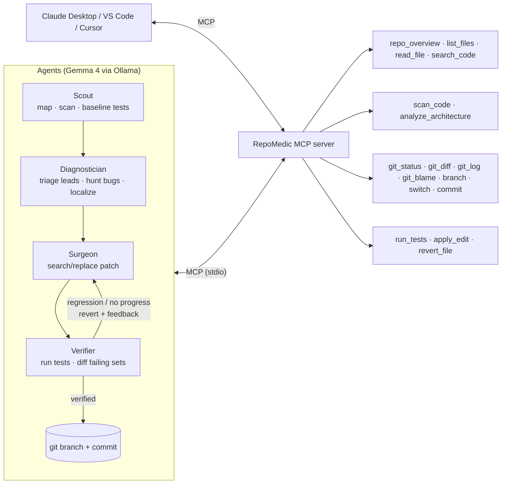

# 🩺 RepoMedic

**A code doctor that runs on your own laptop. It finds bugs in a backend repository, writes the fix, proves the fix with your tests, and commits it to a separate branch.**
It runs on **Google Gemma 4** through **Ollama**, and it reaches the repository through **MCP** tools.

> Your code never leaves your machine. There are no API keys and no cloud calls.

```
repomedic fix ./my-api --issue "GET /products?page=1 skips the first 10 products"

  Scout          🔧 git_status · run_tests        🧪 baseline: 9 failed, 13 passed
  Diagnostician  💭 "Pages are 1-indexed but offset = page * page_size…"
                 🎯 shop/services/catalog.py · list_products
  Surgeon        🩹 -    offset = page * page_size
                    +    offset = (page - 1) * page_size
  Verifier       🧪 attempt 1: 7 failed, 15 passed  → 2 tests fixed, 0 regressions
                 ✔ committed on repomedic/product-listing-skips-the-first-page
```

## Why it's different

| | Typical "AI code review" | **RepoMedic** |
|---|---|---|
| Where it runs | Sends your code to a cloud LLM | **Local Gemma on Ollama.** Works offline, so it's safe for private or regulated code |
| How it finds bugs | The LLM reads files and guesses | **Neuro-symbolic.** 18 deterministic AST and architecture detectors produce leads, Gemma judges each one in context, and a Gemma agent hunts for logic bugs using failing tests as evidence |
| Fixes | Suggestions you have to trust | **Verified fixes.** Patch, run tests, and on any regression revert and retry with the test output as feedback, then commit to a new branch |
| Tools | Hard-wired into one app | **An MCP server with 18 tools.** The same tools work in Claude Desktop, VS Code, Cursor or any other MCP client |
| Evidence | Demo screenshots | **RepoMedic-Bench**, an eval in the style of SWE-bench, the agent gets only the issue text, and ground-truth tests it is never told about decide pass or fail |

## Architecture



**How it uses Gemma**
- **Native function calling with Gemma 4.** The model gets the MCP tool schemas as Ollama tool definitions.
- **Automatic fallback to grammar-constrained JSON.** If a model doesn't produce tool calls (for example Gemma 3, which has no native tool support), the same agent loop switches to Ollama structured outputs mid-run. Any Gemma model works.
- **Built for small models.** RepoMedic narrows the search by keywords and failing tests before Gemma reads any code. It shows Gemma the tests that must pass, and it keeps the context small by truncating old tool output. Edits are search/replace, matched with indentation tolerance and syntax-checked before they are written, so a 4B model can make the right change.
- **Optional thinking mode** (`REPOMEDIC_THINK=1`). Gemma's reasoning streams into the UI timeline.

**Safety**
- Every path is sandboxed to the repository root, and `.git` is off-limits.
- Python edits are compiled before they are written.
- Fixes go on a new branch, and the tool refuses to run on a dirty working tree.
- `--sandbox` works on a disposable copy.
- Tests run with a timeout.

## Quickstart

```powershell
# 1. Install Ollama (https://ollama.com), then:
ollama pull gemma4:e4b                 # laptop-friendly. gemma4:26b is better quality; gemma4:31b-cloud if your machine is weak

# 2. Install RepoMedic
powershell -ExecutionPolicy Bypass -File scripts\setup.ps1     # or: bash scripts/setup.sh

# 3. Use it
.\.venv\Scripts\repomedic scan bench\buggy_shop                # static + architecture scan, no LLM needed
.\.venv\Scripts\repomedic diagnose bench\buggy_shop            # Gemma triage + bug hunt -> reports/*.md
.\.venv\Scripts\repomedic fix bench\buggy_shop --sandbox --issue "Applying coupon WELCOME10 raises TypeError"
.\.venv\Scripts\repomedic serve                                # live web UI -> http://127.0.0.1:8765
.\.venv\Scripts\repomedic bench                                # RepoMedic-Bench
```

### Use the MCP server from any client

```jsonc
// Claude Desktop: claude_desktop_config.json (see examples/)
{ "mcpServers": { "repomedic": { "command": "<repo>/.venv/Scripts/repomedic-mcp.exe", "args": ["--root", "C:/path/to/repo"] } } }
```
The server also ships two MCP prompts, `diagnose_repository` and `fix_issue`.

## RepoMedic-Bench

`bench/buggy_shop` is a small e-commerce backend with **7 realistic seeded bugs** of the kind real backends ship:

| Case | Category | Bug |
|---|---|---|
| pagination-off-by-one | logic | `offset = page * size` with 1-indexed pages |
| sql-injection-search | security | f-string SQL in `LIKE` search |
| mutable-default-cart | logic | `items=[]` default shares carts across users |
| naive-datetime-coupon | reliability | naive `datetime.now()` vs aware expiry, causing a TypeError |
| idor-cancel-order | security | missing ownership/admin check (IDOR) |
| oversell-stock | logic | stock reserved without an availability check |
| missing-404 | api-contract | not-found returns HTTP 200 |

For each case the harness copies the repo, runs `git init`, and gives the agent **only the issue text**. The case passes only if its **ground-truth tests** pass afterwards. `--attempts 1` runs the ablation without the verify-and-retry loop.

```powershell
repomedic bench --model gemma4:e4b
repomedic bench --model gemma4:e4b --attempts 1      # ablation
repomedic bench --model gemma4:e4b --tool-mode json  # constrained-JSON mode
```

**Results** (`gemma4:e4b`, CPU-only on a 16 GB laptop, fully offline):

| Agent version | Resolved | False claims | Avg time / bug |
|---|---|---|---|
| v1: search/replace edits, failing tests only | 3/7 (43%) | 0 | 225s |
| **v2: function-level rewrites + guard tests + error-driven retries** | **7/7 (100%)** | **0** | **205s** |

The model, the bugs and the judging tests were the same in both runs; only the agent design changed:
1. **Function-level edits.** Gemma rewrites the whole function, and RepoMedic swaps it in by AST. Two of the cart bug's three v1 attempts never applied because the search text didn't exactly match the file.
2. **Guard tests.** Gemma sees every test that calls the function, including ones that pass today. In v1 the SQL fix kept dropping the `%` wildcards and breaking substring search, and the IDOR fix had no way to know admins may cancel.
3. **Error-driven retries.** Retries get the previous diff, the source of the tests that broke, and the assertion lines, at a higher temperature.
4. **CPU-friendly context.** The Surgeon gets the function plus an outline of the rest of the file (70% fewer tokens).

Every v2 patch is the idiomatic fix: parameterized `LIKE ?` with `%term%` bound, `items=None`, `datetime.now(timezone.utc)`, an owner-or-admin check, a stock check before decrementing, and `404`. Raw results are in `bench/results/`.

_Caveat: 7 cases is a small benchmark, and the bugs were seeded by us. Treat it as evidence that the loop works, not as a leaderboard number._

### Held-out suite (overfitting check)
Because v2 was developed against the main 7 cases, we froze the agent design and then wrote a **held-out suite**. It's a different backend, `bench/buggy_bookings` (event-ticket booking), with **3 new bug types**:
- case-insensitive email duplicates;
- a declined payment that still holds seats (ordering / consistency);
- dates stored as `DD/MM/YYYY` text, so they're compared and sorted as text.

A static scan of it finds **0 findings**. These are pure logic bugs, so the suite tests the model's reasoning, not our detectors.

```powershell
repomedic bench --suite heldout      # or --suite all for all 10 cases
```

**Benchmark integrity:** `bench/gold_patches.py` has a reference fix for every case (never shown to the agent). `tests/test_bench_cases.py` proves, for all 10 cases, that the bug breaks the judging tests and the reference fix repairs exactly those tests without breaking anything else.

## Project layout

```
repomedic/
  mcp_server/   server.py (18 MCP tools + 2 prompts) · analyzers.py · architecture.py · editing.py · testing.py · sandbox.py · gitops.py
  agent/        llm.py (Ollama: tools + structured output) · toolbox.py (MCP client) · agents.py (tool loop) · orchestrator.py · prompts.py
  web/          app.py (FastAPI + SSE) · static/index.html
  cli.py · benchmark.py · report.py · workspace.py
bench/          buggy_shop/ + cases.json (main) · buggy_bookings/ + heldout_cases.json (held-out) · gold_patches.py
tests/          analyzers, editing/sandbox, symbols, full fix pipeline over real MCP stdio with a scripted LLM, benchmark integrity
```

## Roadmap
- Tree-sitter analyzers for JS/TS, Go and Java (the MCP tools themselves are already language-agnostic)
- The Surgeon writes a regression test for every fix
- A GitHub Action / PR bot mode using the same MCP server
- Fine-tune a small Gemma on RepoMedic's own verified fix trajectories


## License
MIT
