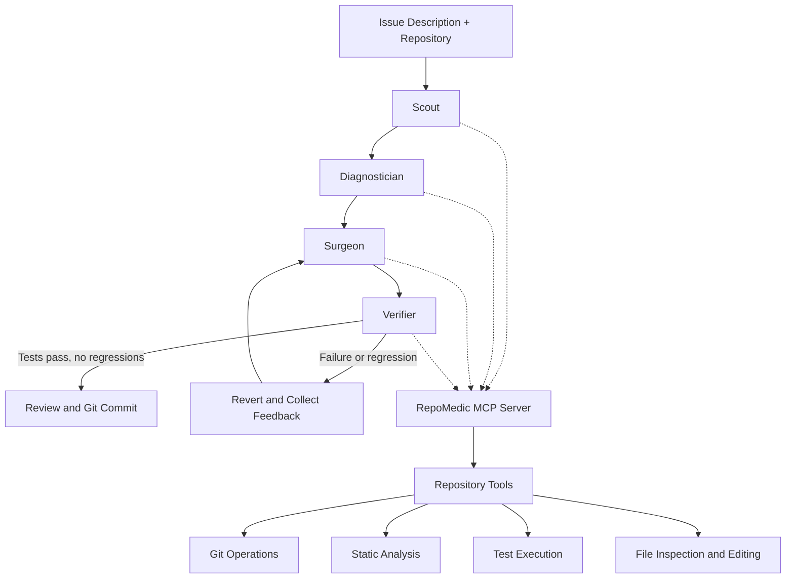

# 🩺 RepoMedic

**A local-first AI code doctor that finds bugs in backend repositories, proposes fixes, validates them against tests, and commits verified changes to a separate Git branch.**

RepoMedic aims to combine **local language models, deterministic code analysis, and test-driven verification** to help developers debug backend applications without sending their source code to cloud-based AI services.

The system is planned to use **Google Gemma through Ollama** for local inference and the **Model Context Protocol (MCP)** to expose repository inspection, testing, editing, and Git operations as reusable tools.

> **Our goal:** Build a code-repair agent that does not just suggest a fix, but attempts to demonstrate that the fix works.

## 🎯 Project Vision

Debugging backend repositories often requires developers to trace execution paths, identify logic errors, understand existing tests, implement patches, and verify that changes do not introduce regressions.

RepoMedic aims to automate this workflow through a controlled, locally executed agent pipeline.

The proposed system will:

- Analyze a repository using deterministic static and architectural checks.
- Use a local Gemma model to investigate suspicious code and reason about potential bugs.
- Generate targeted patches based on the issue description and available test evidence.
- Run tests to evaluate the proposed changes.
- Revert unsuccessful patches and use test failures to guide subsequent attempts.
- Commit successful fixes to a separate Git branch, leaving the original branch untouched.

The project will prioritize local execution, reproducibility, and evidence-backed code modifications.

## ✨ Proposed Features

| Feature | Planned functionality |
|---|---|
| Local inference | Run Gemma through Ollama without requiring external LLM API calls. |
| Deterministic analysis | Develop AST-based detectors for common coding errors and architectural issues. |
| Context-aware diagnosis | Use repository structure, code search, and test output to investigate potential bugs. |
| Automated patching | Generate targeted source-code edits with syntax and safety checks. |
| Test-driven verification | Run tests before and after changes to identify fixes and regressions. |
| Retry and recovery | Revert unsuccessful patches and retry using previous errors as feedback. |
| Git isolation | Create a dedicated branch for proposed fixes and commit only after verification. |
| MCP integration | Expose repository operations through an MCP server for compatible development clients. |
| Interactive interface | Build a web interface for viewing agent progress, diagnostics, patches, and test results. |
| Benchmarking | Evaluate repair success against known bugs and independent test suites. |

## 🏗️ Proposed Architecture

The architecture will be organized around four cooperating stages.



### 1. Scout — Repository Reconnaissance

The Scout will establish the repository's initial state and gather relevant evidence.

Planned responsibilities:
- Inspect repository structure and source files.
- Check Git status and ensure the working tree satisfies the safety requirements.
- Run baseline tests and record existing failures.
- Identify relevant modules and potential code hotspots.

### 2. Diagnostician — Bug Investigation

The Diagnostician will combine deterministic analysis with local model reasoning.

Planned responsibilities:
- Run static and architectural detectors.
- Rank potential findings based on the issue description and available evidence.
- Examine relevant functions and call paths.
- Use test failures and assertion messages to narrow down the likely cause.
- Produce a diagnosis identifying the suspected location and root cause.

### 3. Surgeon — Patch Generation

The Surgeon will attempt to implement the smallest reasonable correction.

Planned responsibilities:
- Generate targeted edits or function-level replacements.
- Apply changes through repository tools.
- Validate edits for syntax and structural correctness.
- Preserve unrelated functionality and minimize the scope of modifications.

### 4. Verifier — Test-Driven Validation

The Verifier will evaluate whether a proposed fix behaves as intended.

Planned responsibilities:
- Run relevant tests after applying a patch.
- Compare post-patch failures against the baseline.
- Detect newly introduced regressions.
- Feed failure details back into the repair loop.
- Revert unsuccessful attempts and retry within a configurable limit.
- Permit a commit only when the configured verification criteria are satisfied.

Passing tests will be treated as evidence of correctness, not a guarantee that every possible bug has been eliminated.

## 🧠 Planned Technology Stack

| Component | Proposed technology |
|---|---|
| Local language model | Google Gemma |
| Inference runtime | Ollama |
| Agent orchestration | Python |
| Repository integration | Model Context Protocol (MCP) |
| Static analysis | Python AST and custom deterministic detectors |
| Backend and API | FastAPI |
| Interactive updates | Server-Sent Events (SSE) |
| Version control | Git |
| Testing | Pytest and repository-specific test suites |
| Benchmarking | Custom benchmark harness with hidden judging tests |

The final implementation may evolve as we evaluate model compatibility, performance, and resource requirements.

## 🔐 Privacy and Safety by Design

RepoMedic is being designed around local execution and controlled repository access.

Planned safeguards include:

- **Local inference:** Use a locally running Ollama model without external LLM API calls in the default workflow.
- **Repository boundaries:** Restrict file access and modifications to the selected repository root.
- **Protected Git metadata:** Prevent ordinary file-editing tools from accessing `.git` internals.
- **Clean working tree checks:** Refuse automated repair when pre-existing uncommitted changes could be affected.
- **Branch isolation:** Keep repair attempts separate from the user's original branch.
- **Sandbox mode:** Support testing against a disposable repository copy.
- **Syntax validation:** Check generated edits before writing them where applicable.
- **Bounded execution:** Apply timeouts and limits to test runs and repair attempts.
- **Verification before commit:** Require the configured checks to pass before creating an automated commit.

Local execution reduces exposure to external services, but it does not eliminate risks from malicious repositories, unsafe tests, or incorrectly generated patches. Additional execution isolation and permission controls will be considered as part of implementation.

## 🧪 Planned Evaluation: RepoMedic-Bench

A central project goal is to measure whether RepoMedic can repair realistic bugs rather than merely generate plausible explanations.

We plan to develop **RepoMedic-Bench**, a reproducible benchmark containing deliberately faulty backend repositories and independent judging tests.

### Initial benchmark: Buggy Shop

The proposed e-commerce backend benchmark will cover seven bug categories:

| Case | Category | Intended defect |
|---|---|---|
| Pagination off-by-one | Logic | Incorrect offset for one-indexed pages |
| SQL injection search | Security | Unsafe construction of SQL search queries |
| Mutable default cart | Logic | Shared mutable state between requests |
| Naive datetime coupon | Reliability | Incompatible timezone-aware and naive datetime values |
| IDOR order cancellation | Security | Missing ownership or administrator authorization checks |
| Overselling stock | Logic | Missing inventory availability validation |
| Missing 404 response | API contract | Returning success for a nonexistent resource |

### Held-out benchmark: Buggy Bookings

To evaluate generalization beyond the initial examples, we plan a second benchmark based on an event-ticket booking backend.

It will investigate three additional defect types:

- Case-insensitive email uniqueness violations.
- Seat reservations remaining active after a payment failure.
- Incorrect date comparisons caused by storing dates as `DD/MM/YYYY` strings.

The held-out suite is intended to test the model's ability to reason about bugs that cannot be identified by the initial set of deterministic detectors.

### Evaluation methodology

The benchmark harness is planned to:

1. Create an isolated copy of each faulty repository.
2. Initialize a clean Git environment.
3. Provide the agent with the issue description rather than the reference patch.
4. Run independent judging tests after the repair attempt.
5. Record successful repairs, regressions, execution time, and failure reasons.
6. Compare alternative agent configurations, including repair retries and different tool-calling modes.

Reference patches will be kept separate from the agent's inputs. We will also test whether those patches repair the intended failures without introducing unrelated regressions.

### Target evaluation metrics

- **Repair success rate:** Percentage of benchmark cases passing the judging tests.
- **Regression rate:** Frequency of new failures introduced by attempted repairs.
- **False success rate:** Frequency of reporting a fix as successful when the verification criteria have not been met.
- **Average repair time:** Time required to diagnose, patch, and validate a case.
- **Resource usage:** Model latency, token consumption where available, and system resource requirements.
- **Generalization:** Performance on bugs outside the initial development benchmark.

No benchmark performance is claimed at this stage. Results will be published after implementation and repeatable evaluation.

## 🖥️ Planned User Experience

The intended CLI workflow will look similar to the following:

```text
repomedic scan ./my-api

repomedic diagnose ./my-api

repomedic fix ./my-api \
  --issue "GET /products?page=1 skips the first 10 products" \
  --sandbox

repomedic serve
```

The exact command syntax and available options will depend on the final implementation.

The intended repair timeline will show:

```text
[Scout]          Inspecting repository and baseline tests
[Diagnostician]  Investigating the suspected pagination bug
[Surgeon]        Preparing a candidate patch
[Verifier]       Running tests and checking regressions
[Verifier]       Retry required — analyzing test failures
[Git]            Preparing a verified fix on a separate branch
```

This timeline represents the intended user experience, not a report of completed execution.

## 🗺️ Development Roadmap

<text color="secondary" size="sm">Proposed phases — milestones will be marked complete only after implementation and testing.</text>

### Phase 1 — Repository Analysis
- [ ] Establish the Python project structure and CLI.
- [ ] Implement repository inspection and Git-state checks.
- [ ] Develop initial AST-based bug detectors.
- [ ] Add architecture analysis and diagnostic reports.

### Phase 2 — MCP Server
- [ ] Implement repository-reading and code-search tools.
- [ ] Add static analysis, testing, and Git-operation tools.
- [ ] Implement safe editing and recovery operations.
- [ ] Test MCP communication through stdio.

### Phase 3 — Local Agent Pipeline
- [ ] Integrate Gemma through Ollama.
- [ ] Implement the Scout, Diagnostician, Surgeon, and Verifier stages.
- [ ] Support native tool calling where available and structured-output fallback where appropriate.
- [ ] Add context management and bounded repair attempts.

### Phase 4 — Safe Automated Repair
- [ ] Implement patch validation and syntax checks.
- [ ] Compare baseline and post-patch test results.
- [ ] Add regression-aware retry and rollback behavior.
- [ ] Create isolated branches and enforce commit criteria.
- [ ] Test sandbox execution against deliberately faulty repositories.

### Phase 5 — Benchmark and Evaluation
- [ ] Build the initial Buggy Shop benchmark.
- [ ] Add independent judging tests and reference patches.
- [ ] Develop the held-out Buggy Bookings suite.
- [ ] Compare repair strategies and record reproducible results.

### Phase 6 — Interface and Extensibility
- [ ] Build a web interface with a live repair timeline.
- [ ] Add patch previews and test-result summaries.
- [ ] Test integration with compatible MCP clients.
- [ ] Explore additional language analyzers and regression-test generation.

## 🚀 Long-Term Vision

RepoMedic aims to evolve into a language-extensible, locally operated code-repair workbench.

Potential future directions include:
- AST-based analysis for JavaScript, TypeScript, Go, and Java.
- Automatic regression-test generation for proposed fixes.
- Pull-request automation through GitHub integration.
- Training or fine-tuning small models using verified repair trajectories.
- More extensive evaluation across repositories and unseen bug categories.

These extensions will be prioritized based on benchmark evidence and implementation feasibility.

## 📌 Project Status

**Current stage:** Planned / under development.

The architecture, proposed features, benchmark design, and development roadmap define the intended direction of RepoMedic. Implementation progress and performance results will be documented as the project develops.

**License:** MIT (planned).

